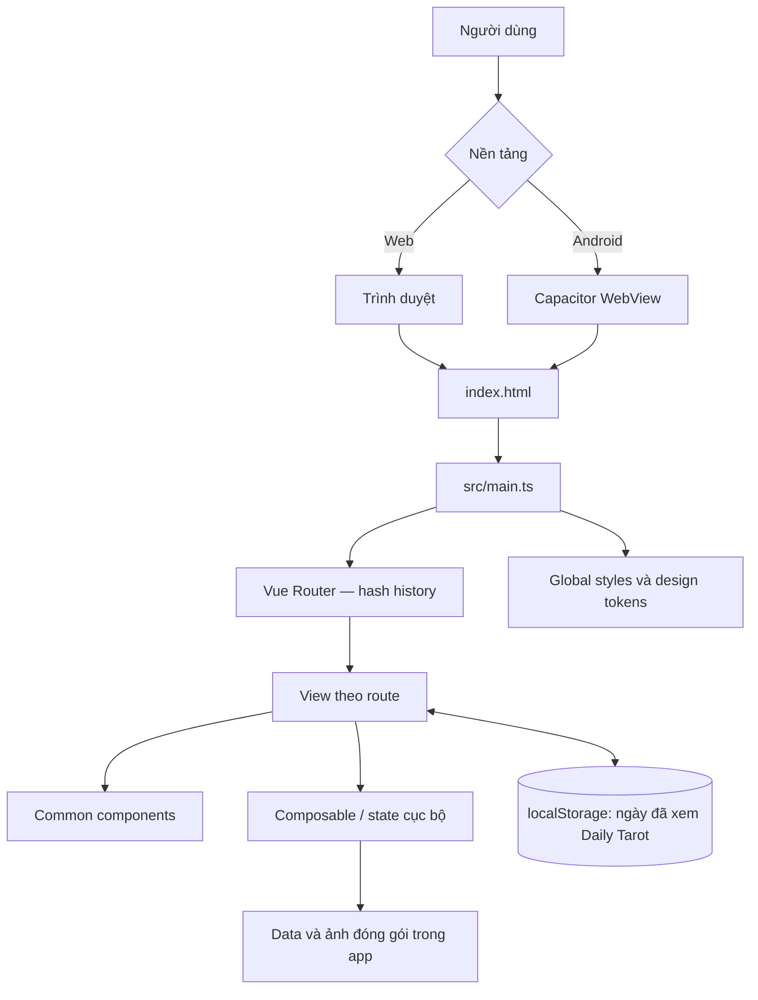
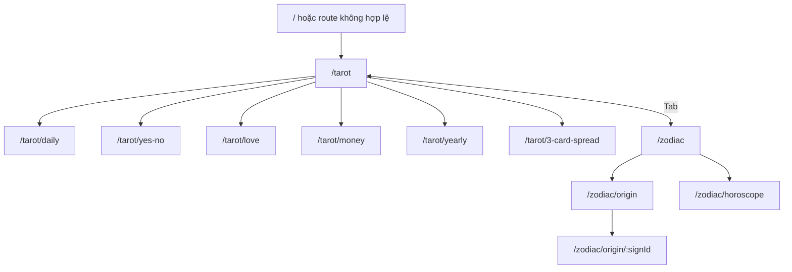
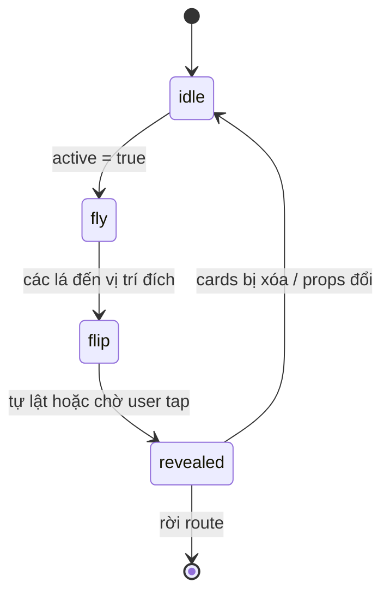
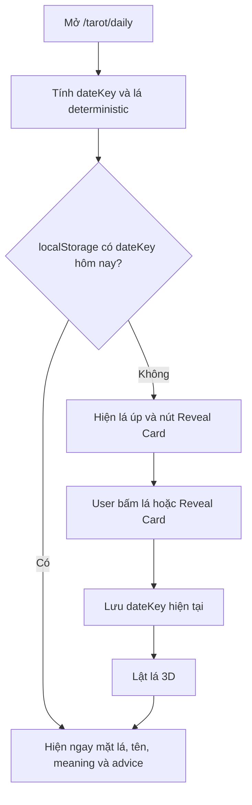
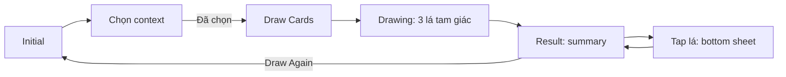
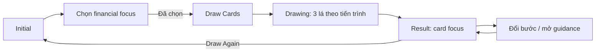
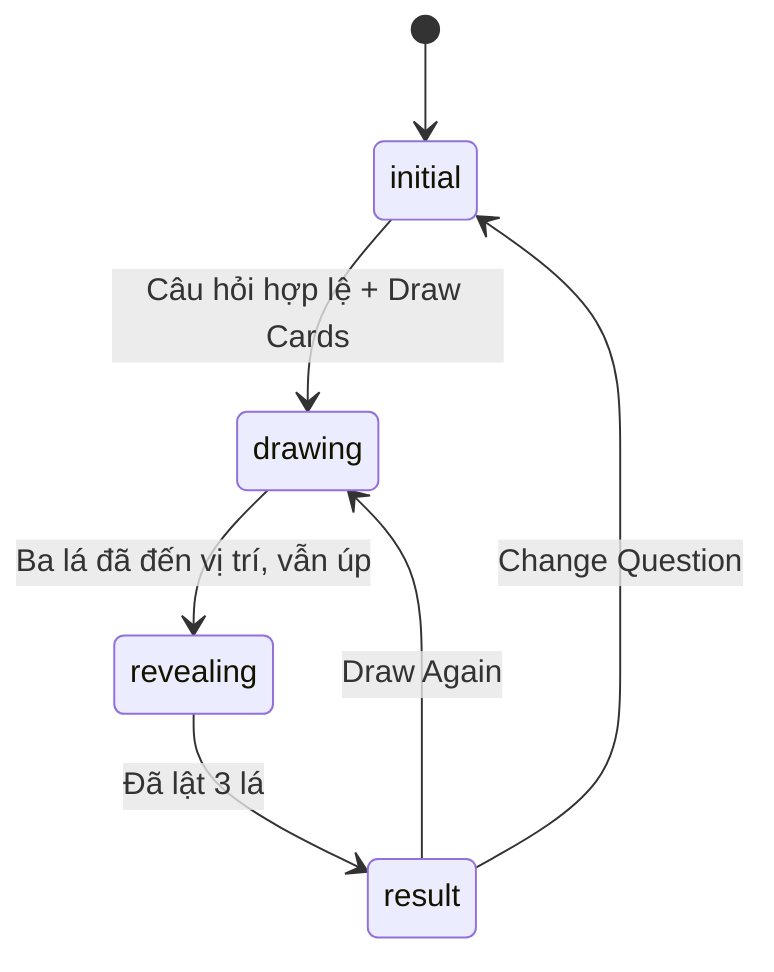
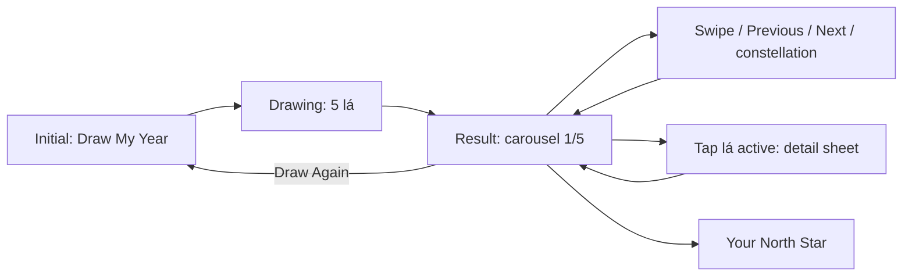

# App Tarot — System flow

> Tài liệu mô tả luồng hệ thống **theo mã nguồn hiện tại**. Settings là màn duy nhất còn ở trạng thái placeholder; các luồng Tarot và Zodiac đã có nghiệp vụ.

## 1. Kiến trúc tổng quan

App Tarot là SPA Vue 3 chạy hoàn toàn ở thiết bị. Cùng một bundle web được dùng trên trình duyệt và trong Capacitor WebView của Android. App không có backend, đăng nhập, cơ sở dữ liệu, API nghiệp vụ, lịch sử kết quả hay đồng bộ giữa các thiết bị.



- `src/data/` chứa bộ bài và helper diễn giải; toàn bộ nội dung Tarot chạy offline.
- Ảnh mặt bài nằm ở `public/cards/`; ảnh minh họa tile chức năng nằm ở `src/assets/cards/`.
- Font Cinzel được khai báo trong `src/styles/tokens.css` qua Google Fonts. Nếu mạng không khả dụng, app vẫn chạy với font dự phòng.
- `localStorage` chỉ được dùng cho Daily Tarot. Không lưu tên lá, câu hỏi, kết quả Yes/No hay các lượt rút khác.

## 2. Khởi động ứng dụng

### 2.1. Web

1. `index.html` tạo phần tử `#app` và nạp `src/main.ts`.
2. `main.ts` nạp token, global style, animation style và screen style; sau đó tạo Vue app, đăng ký router rồi mount vào `#app`.
3. `App.vue` render `RouterView`; route hiện tại quyết định view được hiển thị.
4. Router dùng `createWebHashHistory()`, nên URL có dạng `/#/tarot/...` và không cần web server xử lý deep link.
5. Mỗi view được lazy-load bằng dynamic import khi người dùng mở route tương ứng.

### 2.2. Android

1. `MainActivity` kế thừa `BridgeActivity` của Capacitor.
2. Capacitor nạp thư mục `dist` theo cấu hình `webDir: 'dist'` trong `capacitor.config.ts`.
3. Trong WebView, luồng chạy giống bản web: `index.html` → `main.ts` → router → view.
4. `AndroidManifest.xml` khóa activity ở portrait bằng `android:screenOrientation="portrait"`.

Capacitor hiện chỉ là lớp host native; mã nguồn không gọi plugin native hay bridge API nào.

## 3. Điều hướng

Route `/` chuyển về `/tarot`. Mọi route không hợp lệ cũng quay về `/`, rồi được redirect sang Tarot Home.



| Route | View | Trạng thái hiện tại |
| --- | --- | --- |
| `/tarot` | Tarot Home | Hoạt động — 6 tile chức năng và tab Tarot/Zodiac |
| `/tarot/daily` | Card of the Day | Hoạt động |
| `/tarot/yes-no` | Yes or No | Hoạt động |
| `/tarot/love` | Love Tarot | Hoạt động |
| `/tarot/money` | Money Tarot | Hoạt động |
| `/tarot/yearly` | Yearly Tarot | Hoạt động |
| `/tarot/3-card-spread` | 3 Card Spread | Hoạt động |
| `/zodiac` | Zodiac Home | Hoạt động như menu |
| `/zodiac/origin` | Zodiac Origin | Hoạt động — danh sách 12 cung |
| `/zodiac/origin/:signId` | Zodiac Origin Detail | Hoạt động — nội dung chi tiết và fallback sign không tồn tại |
| `/zodiac/horoscope` | Horoscope | Hoạt động — chọn cung và Day/Week/Year |
| `/settings` | Settings | Placeholder |

Nút Back trên các màn Tarot quay về `/tarot`; các màn Zodiac quay về route Zodiac cha. Chuyển route không gửi request trang mới đến server.

## 4. Dữ liệu, rút bài và state

### 4.1. Bộ bài và lượt rút thông thường

Nguồn dữ liệu runtime là `tarot_cardsSQLite.db`, gồm đủ 78 lá: 22 Major Arcana và 56 Minor Arcana. Database lưu metadata Major/Minor, suit/rank, đường dẫn ảnh, meaning, advice và nội dung Yes/No; app chưa hỗ trợ lá ngược.

Khi bootstrap, `main.ts` khởi tạo SQLite, copy database asset với `overwrite = false`, query các lá active theo `deck_order`, map row sang `TarotCard`, rồi nạp vào card store trước khi mount Vue. Nếu DB lỗi, `App.vue` hiển thị trạng thái lỗi và nút retry thay vì màn hình trắng.

`useDrawCards().draw(count)` lấy snapshot 78 lá từ card store, trộn bản sao bằng Fisher–Yates với `Math.random()` rồi lấy `count` lá đầu.

- Không có lá trùng trong cùng một lượt rút.
- Hai lượt rút khác nhau độc lập, vì vậy có thể lặp lại lá ở lượt trước.
- Kết quả rút thông thường chỉ nằm trong state của view; reload hoặc rời route sẽ mất kết quả.

### 4.2. Card of the Day theo ngày

Daily Tarot không rút ngẫu nhiên theo từng người dùng. Lá bài được xác định từ ngày local của thiết bị:

```text
Date hiện tại
  → yyyy-mm-dd
  → hash cơ số 31
  → hash modulo số lá trong card store (78)
  → lá Card of the Day
```

Vì vậy, cùng `dateKey` và cùng phiên bản bộ bài luôn cho cùng một lá. Sau khi user Reveal, view chỉ lưu ngày đã xem:

```text
key   = tarot:daily-revealed-date
value = yyyy-mm-dd
```

- Nếu `value` trùng ngày hiện tại, view mở thẳng mặt trước của lá bài và nội dung diễn giải.
- Nếu chưa có key, key không trùng ngày hiện tại hoặc `localStorage` không khả dụng, view hiển thị mặt sau và nút Reveal.
- Khi Reveal, view ghi `dateKey` hiện tại. Không lưu ID lá hay lịch sử các ngày trước.
- Qua ngày mới, value cũ không còn khớp nên lần mở Daily Tarot tiếp theo quay về lá úp của ngày mới.
- Ngày hiện tại được tính lúc view khởi tạo; nếu để nguyên màn hình qua 0 giờ, user cần mở lại route hoặc reload để nhận lá ngày mới.

### 4.3. Phạm vi state

| State / dữ liệu | Nơi giữ | Vòng đời |
| --- | --- | --- |
| Route hiện tại | Vue Router | Trong phiên chạy, phản ánh trên hash URL |
| Phase, card vừa rút, câu hỏi, context, tab/card đang xem, bottom sheet | `ref` trong từng view | Mất khi view bị hủy hoặc app reload |
| 78 lá bài + Yes/No mapping | SQLite asset → `cardRepository` → `cardStore` | Nạp một lần khi app bootstrap |
| Diễn giải Love/Money/Yearly | `src/data/spreadReadings.ts` | Helper tĩnh, kết hợp với card từ DB |
| Ảnh mặt bài và mặt sau | `public/cards/` | Tĩnh, phục vụ từ root của web bundle |
| Ảnh tile chức năng | `src/assets/cards/` | Vite import và bundle |
| Ngày đã Reveal Daily Tarot | `localStorage` key `tarot:daily-revealed-date` | Giữ qua lần mở app; chỉ có một ngày gần nhất |

Xóa dữ liệu trình duyệt/app sẽ xóa cờ Reveal, nhưng không thay đổi lá của ngày đó vì thuật toán chọn lá là deterministic.

## 5. Cơ chế animation và component dùng chung

Deck dùng card store global read-only; kết quả từng lượt rút vẫn nằm trong state cục bộ của view. Với các trải bài có animation, `CardDrawAnimation` nhận sẵn các lá từ view và đi qua các bước sau:



- `love`: ba lá bay từ hai phía và phía dưới vào bố cục tam giác, sau đó vẽ đường kết nối.
- `money`: ba lá theo hàng/progress path.
- `yes-no`: một lá ở trung tâm.
- `open-question`: ba lá đến vị trí nhưng giữ mặt úp; user tự chọn lá để lật.
- `yearly`: năm lá bay theo cung ngắn trước khi vào carousel của view.
- Các timer animation được dọn khi component unmount.
- Khi thiết bị bật `prefers-reduced-motion`, component bỏ chuỗi chuyển động và phát trạng thái đã reveal ngay. Với 3 Card Spread, cả ba lá được tính là đã reveal ngay.

| Component | Vai trò |
| --- | --- |
| `ScreenHeader`, `ScreenContent` | Khung màn hình, Back, nền và vùng cuộn |
| `CardDrawAnimation` | Fan bài, bay/lật bài, event `revealed`, `card-revealed`, `card-tap` |
| `QuestionInput`, `PrimaryButton` | Nhập câu hỏi và CTA |
| `ContextChipGroup` | Radio chip cho context Love/Money |
| `CardResultItem`, `CardSlotLabel` | Nội dung chi tiết và nhãn vị trí lá |
| `SpreadSummary` | Tổng hợp riêng cho Love/Money |
| `DrawAgainBar` | Draw Again, Change Question (nếu có) và Back |

## 6. Luồng từng chức năng Tarot

### 6.1. Card of the Day



1. `CardOfTheDayView` tính lá hiện tại bằng `getCardOfTheDay(today)` và kiểm tra `tarot:daily-revealed-date`.
2. Nếu đã Reveal trong ngày, `revealed` khởi tạo là `true`; lá được dựng mặt trước ngay, không chạy lại animation lật.
3. Nếu chưa Reveal, user có thể bấm trực tiếp vào lá úp hoặc CTA **Reveal Card**.
4. View lưu `dateKey`, lật lá rồi hiển thị tên, **Meaning**, **Advice** và ghi chú lá sẽ thay đổi ngày mai.
5. Không có input, Draw Again hay thumbnail kết quả trên Tarot Home.

### 6.2. Yes or No

1. User có thể nhập câu hỏi tối đa 140 ký tự, hoặc để trống và giữ câu hỏi trong đầu.
2. **Draw Card** luôn dùng được ở state `initial`; view rút một lá bằng `draw(1)` và chạy `CardDrawAnimation variant="yes-no"`.
3. Khi lật xong, `buildYesNoGuidance(card)` map `card.yesNo` thành **YES**, **NO**, **MAYBE** hoặc **UNCLEAR**.
4. Kết quả hiển thị câu hỏi (nếu có), verdict, mô tả verdict, tên lá, **Why this answer** từ `yesNoMeaning` và **Guidance** từ `advice`.
5. **Draw Again** chỉ xóa lá, giữ nguyên câu hỏi để rút lại. Nút **Clear question** chỉ xuất hiện ở state nhập khi câu hỏi có nội dung. Rời route sẽ xóa state của view.

### 6.3. Love Tarot



1. User bắt buộc chọn một context: **Single**, **Exploring** hoặc **In a relationship**.
2. View rút ba lá không trùng và gắn nhãn **You / Their Energy / Connection**.
3. `CardDrawAnimation variant="love"` trình bày ba lá theo tam giác; sau khi lật xong, user có thể tap từng lá để mở bottom sheet.
4. Nội dung mỗi lá được dựng từ `getLoveCardReading(card, index, context)`. `SpreadSummary` tạo **Message for the connection** từ ba lá.
5. **Draw Again** xóa bộ ba hiện tại nhưng giữ context đã chọn. Back quay về `/tarot`.

### 6.4. Money Tarot



1. User chọn **General finances**, **Income & career** hoặc **Spending**. Chưa chọn thì CTA bị vô hiệu hóa.
2. View rút ba lá không trùng với nhãn **Current Position → Opportunity / Obstacle → Next Action**.
3. Sau animation `variant="money"`, kết quả tập trung một lá lớn tại một thời điểm. User chuyển giữa ba bước bằng tab hoặc nút Previous/Next.
4. Mỗi bước có meaning theo context từ `getMoneyCardReading`. Bấm vào lá hoặc **View full guidance** mở bottom sheet chi tiết.
5. `SpreadSummary` hiển thị **Opportunity / Watch carefully / Next step** và disclaimer: nội dung chỉ để tham khảo, không phải tư vấn tài chính.
6. **Draw Again** quay về form chọn focus nhưng vẫn giữ lựa chọn trước đó.

### 6.5. 3 Card Spread



1. User nhập câu hỏi mở bắt buộc, tối đa 160 ký tự. Sau khi trim, câu hỏi rỗng sẽ làm CTA bị vô hiệu hóa.
2. View rút ba lá và chạy `CardDrawAnimation variant="open-question"` theo bố cục tam giác. Các lá đến vị trí nhưng không tự lật.
3. Ở state `revealing`, user tap từng lá để lật; chỉ báo **Revealed n of 3** được cập nhật. **Reveal All** lật tuần tự những lá còn úp.
4. Khi đủ ba lá đã reveal, màn hình hiện **Combined message** tạo từ ba lá. Tap lá sau đó mở bottom sheet chứa meaning/advice chung của lá; không gán Past/Present/Future hay nhãn vị trí.
5. **Draw Again** rút ba lá mới và giữ câu hỏi. **Change Question** trở về form, giữ text hiện tại để user sửa. Back về `/tarot` sẽ hủy state trong view.

### 6.6. Yearly Tarot



1. User bấm **Draw My Year**; không có input hay context bắt buộc.
2. View rút năm lá không trùng, theo thứ tự **Overview / Love / Career / Finance / Health**, rồi chạy `CardDrawAnimation variant="yearly"`.
3. Sau animation, result là carousel ngang. Card active lớn ở giữa; user có thể swipe, dùng Previous/Next hoặc bấm constellation dot. Counter, dot và active card được đồng bộ.
4. Khi user đến một card, index đó được đánh dấu đã xem. Tap lại card active mở bottom sheet gồm **Energy / What to nurture / What to watch**.
5. Khối **Your North Star** luôn có thể mở thủ công. Sau khi user đã xem đủ năm lá, khối này tự mở một lần.
6. Detail của **Finance** và **Health** hiển thị disclaimer tương ứng về tài chính/y tế. **Draw Again** rút năm lá mới và reset carousel về card đầu.

## 7. Zodiac hiện tại

Zodiac dùng chung SQLite v2 với Tarot và hoạt động hoàn toàn offline:

| Route | Luồng đã triển khai |
| --- | --- |
| `/zodiac/origin` | Đọc 12 profile từ `zodiacStore`, hiển thị picker 3 cột |
| `/zodiac/origin/:signId` | Resolve slug, hiển thị origin/traits/gifts/challenges; có empty state cho id sai |
| `/zodiac/horoscope` | Chọn cung, giữ period Day/Week/Year và đọc một trong 36 nội dung tĩnh |

`ZodiacSignPicker` dùng được ở chế độ link hoặc button. `PeriodTabs` dùng `role="tablist"`, hỗ trợ phím trái/phải. Nhánh Zodiac không gọi API và không lưu lựa chọn vào local storage.

## 8. Ranh giới trách nhiệm của mã nguồn

```text
app/
├── src/main.ts                   # Nạp card + zodiac stores trước khi mount Vue
├── src/router/index.ts           # Bảng route và fallback
├── src/views/                    # State + điều phối hành vi từng màn
├── src/components/common/        # UI, animation và interaction tái sử dụng
├── src/database/                 # SQLite connection, mapper, repository, upgrades
├── src/stores/                   # Card/Zodiac singleton stores, trạng thái ready/error
├── src/types/                    # Type Tarot và Zodiac/Horoscope
├── src/composables/useDrawCards.ts
│                                # Trộn/rút bài không trùng trong một lượt
├── src/data/cards.ts             # Legacy 22 Major, chỉ dùng kiểm tra migration
├── src/data/cardOfTheDay.ts      # dateKey + hash chọn lá Daily
├── src/data/yesNo.ts             # Verdict và guidance Yes/No
├── src/data/spreadReadings.ts    # Diễn giải Love/Money/3 Card/Yearly
├── public/assets/databases/      # SQLite deploy asset + web manifest/wasm
├── public/cards/                 # 78 mặt trước + mặt sau card SVG
├── src/assets/cards/             # Ảnh tile Tarot Home
├── capacitor.config.ts           # Cấu hình bundle cho Capacitor
└── android/                      # Android host, manifest và Gradle project
```

- View sở hữu `phase`, phản hồi event của component và quyết định khi nào rút bài.
- Database/repository cung cấp deck; data module còn lại cung cấp helper diễn giải thuần.
- Common component nhận props/phát event, không tự quyết định nghiệp vụ của một flow.
- Router chỉ ánh xạ URL sang view; không có auth guard vì app không có tài khoản.

## 9. Build và đóng gói

### Chạy phát triển

```bash
cd app
npm run dev
```

### Tạo production bundle

```bash
cd app
npm run build
```

Lệnh build chạy `vue-tsc -b` trước, sau đó Vite tạo bundle trong `app/dist`.

### Đồng bộ sang Android

```bash
cd app
npx cap sync android
npx cap open android
```

Luồng phát hành:

```text
Vue/TypeScript source
  → vue-tsc kiểm tra kiểu
  → Vite tạo app/dist
  → Capacitor sync Android
  → Gradle / Android Studio tạo APK hoặc AAB
  → MainActivity mở bundle trong WebView portrait
```

## 10. Trạng thái triển khai

| Khu vực | Trạng thái |
| --- | --- |
| Vue/Vite, global styles, hash router | Đã có |
| Android Capacitor host và portrait lock | Đã có |
| SQLite card database, repository/store, 78 lá và ảnh bài | Đã có |
| Daily Tarot deterministic + lưu Reveal theo ngày | Đã có |
| Yes or No | Đã có |
| Love Tarot | Đã có |
| Money Tarot | Đã có |
| 3 Card Spread | Đã có |
| Yearly Tarot | Đã có |
| Zodiac Home | Đã có như menu |
| Zodiac Origin, Origin Detail, Horoscope | Đã có |
| Settings | Placeholder |
| Backend, tài khoản, lịch sử, share, lá ngược | Ngoài phạm vi hiện tại |
| Automated tests và CI | Đã có cho helper nghiệp vụ, database và production build |

## 11. Kiểm tra thủ công nên thực hiện

1. Daily Tarot: Reveal một lá, rời route rồi mở lại trong cùng ngày phải hiện ngay lá đó; đổi ngày thiết bị hoặc thay `dateKey` phải trở về card úp.
2. Yes/No: thử câu hỏi rỗng, clear question, Draw Again và cả bốn verdict từ data card.
3. Love/Money: CTA không chạy khi chưa chọn context; Draw Again giữ context; mở/đóng bottom sheet đúng lá.
4. 3 Card Spread: câu hỏi chỉ có khoảng trắng không được rút; tap từng lá, Reveal All, Draw Again và Change Question phải giữ đúng state.
5. Yearly: swipe, nút Previous/Next và constellation dot phải đồng bộ; sau đủ năm lá, North Star chỉ auto-open một lần.
6. Bật `prefers-reduced-motion` và kiểm tra mọi flow vẫn đến đúng kết quả.
7. Sau `npm run build`, chạy `npx cap sync android` trước khi kiểm tra trên Android.
